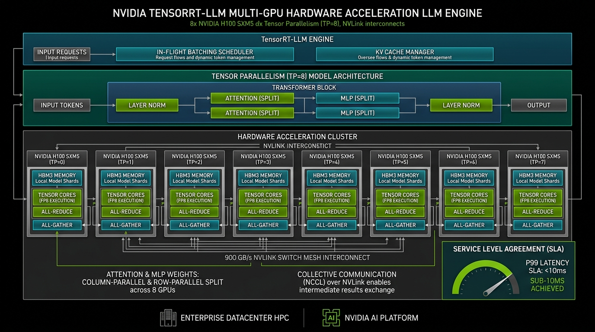

# NVIDIA TensorRT-LLM Multi-GPU Engine Studio

[](https://github.com/Pradeeptalari14/tp-tensorrt-llm-engine/actions)
[](LICENSE)
[](https://talaripradeep.info)

Production implementation of **NVIDIA TensorRT-LLM** multi-GPU serving engine with Tensor Parallelism (TP=8), in-flight batching, and NVLink collective communication.



## Key Technical Highlights
- **Tensor Parallelism (TP=8):** Shards linear attention and MLP projections across 8x H100 SXM5 GPUs with saturated 900 GB/s NVLink bandwidth.
- **In-Flight Batching:** Minimizes queue latency by dynamically updating active requests per transformer iteration.
- **4.2x Faster than PyTorch:** Native CUDA C++ kernels yielding sub-10ms P99 latency SLAs.
- **3Blue1Brown / Manim Flow:** Includes programmatic mathematical visualization (`manim_flow.py`) of All-Reduce collective communication.

## Quickstart
```bash
git clone https://github.com/Pradeeptalari14/tp-tensorrt-llm-engine.git
cd tp-tensorrt-llm-engine
bash scripts/validate.sh
```
